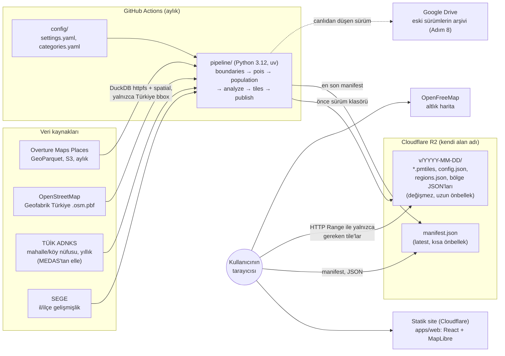
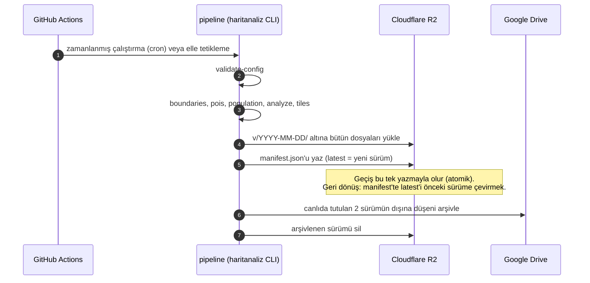
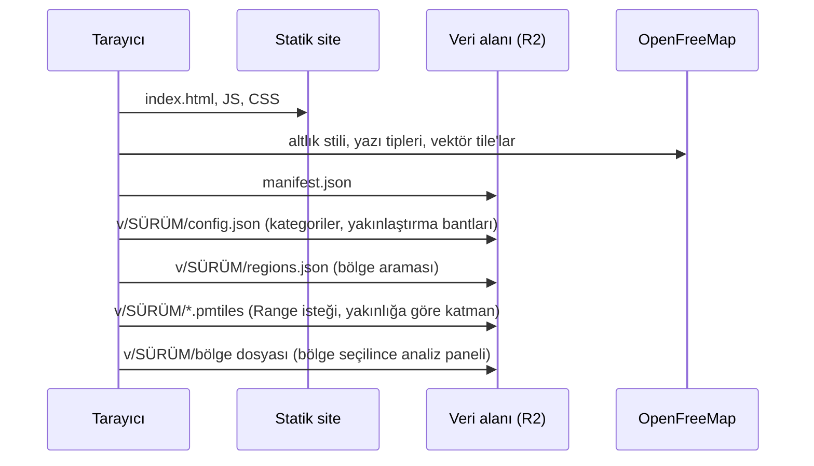

# Mimari

haritanaliz sunucusuz bir sistemdir. Veri ayda bir GitHub Actions'ta işlenir; sonuçlar Cloudflare R2'ye sürümlü dosyalar olarak yüklenir; statik site bu dosyaları doğrudan tarayıcıda okur. Kullanıcı isteği sırasında hiçbir sunucuda hesaplama yapılmaz (K-001).

> Durum (Adım 0): web iskeleti, pipeline CLI iskeleti, config doğrulama ve veri sözleşmesi hazır. Veri çekme, analiz, tile üretimi ve Cloudflare kurulumu sonraki adımlarda yapılacak. Kararların gerekçeleri `docs/decisions.md`'de (K-xxx).

## Bileşenler ve veri akışı



## Veri yenileme (aylık)



Kurallar:
- Sürüm klasöründeki dosyalar yayından sonra asla değişmez. Bu yüzden `Cache-Control: public, max-age=31536000, immutable` ile sunulabilir.
- `manifest.json` kısa önbellekle sunulur (ör. `max-age=60`). Yeni sürüm birkaç dakika içinde bütün kullanıcılara ulaşır.
- R2'de canlıda en az 2 sürüm kalır (`publish.keep_live_versions`); geri dönüş anında yapılabilir.

## Tarayıcıda yükleme



Yakınlaştırmaya göre katmanlar (`config/settings.yaml` → `map.zoom_bands`):

| Bant | Yakınlık | Gösterilen |
|---|---|---|
| Türkiye / il ölçeği | 0–9 | il ve ilçe skor haritası (choropleth) |
| İlçe ölçeği | 9–14 | mahalle/köy skor haritası, H3 yoğunluk katmanı |
| Sokak ölçeği | 14+ | filtrelenen işletmelerin noktaları |

## Depo yapısı

```text
haritanaliz/
├─ CLAUDE.md, README.md
├─ apps/web/                    statik site
│  ├─ public/data-sample/       örnek veri sürümü (manifest.json, v/2026-10-20/)
│  ├─ src/
│  │  ├─ data/                  veri sözleşmesi: manifest, config, bölgeler, sorgular
│  │  ├─ state/                 Zustand store'ları, URL eşitleme
│  │  ├─ map/                   MapLibre kurulumu, pmtiles protokolü, Türkçe etiketler
│  │  ├─ components/            üst bar, filtre paneli, bottom sheet, atıflar
│  │  └─ lib/                   Türkçe arama normalizasyonu, doğrulama yardımcıları
│  └─ e2e/                      Playwright testleri ve ekran görüntüleri
├─ pipeline/                    Python paketi (haritanaliz CLI)
│  ├─ src/haritanaliz/          cli, config (pydantic), manifest, webconfig, paths
│  └─ tests/
├─ config/                      settings.yaml, categories.yaml
├─ docs/                        architecture, decisions, methodology, data_sources, progress
├─ .github/workflows/           ci.yml (veri yenileme ve yayın iş akışları sonra)
└─ data/                        yerel önbellek (git'e girmez)
```

## Web uygulaması

- **Durum:** Filtreler (`categories`, `metric`, `regionId`, `mode`) bir Zustand store'unda tutulur (`src/state/store.ts`). Store açılışta URL'den okunur; `useUrlSync` her değişikliği `history.replaceState` ile sorgu dizesine yazar (K-028). Paylaşılmayan arayüz durumu (panel açık mı, yakınlık, harita durumu) ayrı bir store'dadır (`src/state/ui.ts`).
- **Sunucu verisi:** TanStack Query; manifest 5 dakikada bir tazelenir, sürüm dosyaları hiç tazelenmez (değişmez oldukları için).
- **Harita:** MapLibre 6 (WebGL2). Worker adresi ve `pmtiles://` protokolü açılışta bir kez kaydedilir (`src/map/maplibre.ts`). Açılışta Türkiye'nin tamamı gösterilir. URL hash'inde bir konum varsa harita oradan açılır.
- **Düzen:** 768 px ve üstünde açılır-kapanır sol panel, altında modal olmayan bottom sheet (K-033). Atıf alanı her iki düzende de her zaman görünür.
- **Paketleme:** MapLibre, React ve diğer kütüphaneler ayrı chunk'lara bölünür; uygulama kodu değiştiğinde tarayıcı bunları yeniden indirmez.

## Veri sözleşmesi (şema sürümü 1)

`manifest.json`:

```json
{
  "schema_version": 1,
  "sample": false,
  "latest": "2026-11-03",
  "versions": [
    {
      "version": "2026-11-03",
      "path": "v/2026-11-03/",
      "published_at": "2026-11-03T04:12:00Z",
      "files": { "config": "config.json", "regions": "regions.json" },
      "sources": [{ "id": "overture", "name": "Overture Maps Places", "version": "…", "license": "…" }]
    },
    { "version": "2026-10-06", "path": "v/2026-10-06/", "…": "…" }
  ]
}
```

Kurallar (pipeline'da `manifest.py`, web'de `src/data/manifest.ts` doğrular): sürümler `YYYY-MM-DD` biçiminde geçerli tarihlerdir, en yeniden en eskiye sıralanır, `path` sürümle biter, `latest` listede bulunur. Sürüm klasöründeki dosyalar:

| Dosya | Üreten | İçerik |
|---|---|---|
| `config.json` | `haritanaliz export-web-config` | kategori grupları, kategoriler, yakınlaştırma bantları |
| `regions.json` | `boundaries` | aranabilir bölge listesi: kimlik, ad, düzey, üst bölge |
| `*.pmtiles` | `tiles` | sınırlar, skorlar, H3, işletme noktaları |
| bölge JSON'ları | `analyze` | analiz paneli verisi |

Geliştirmede web, `apps/web/public/data-sample/` altındaki örnek sürümü okur (`sample: true`; arayüzde "örnek" olarak işaretlenir). Gerçek veri adresi `VITE_DATA_BASE_URL` ile verilir.

## Pipeline

`pipeline/` bir uv projesidir; CLI `uv run haritanaliz <komut>` ile çalışır.

| Komut | Durum | Görev |
|---|---|---|
| `validate-config` | hazır | `settings.yaml` ve `categories.yaml`'ı pydantic ile doğrular |
| `export-web-config` | hazır | web için `config.json` üretir |
| `boundaries` | yer tutucu | il/ilçe/mahalle/köy sınırları, yaklaşık (Voronoi) sınırlar |
| `pois` | yer tutucu | Overture + OSM işletmeleri, eşleştirme ve güven skoru |
| `population` | yer tutucu | ADNKS nüfusları, SEGE |
| `analyze` | yer tutucu | göstergeler, sayım modelleri, skorlar |
| `tiles` | yer tutucu | tippecanoe → PMTiles (Linux/WSL) |
| `publish` | yer tutucu | R2'ye sürümlü yükleme, manifest, arşiv |

Config dosyalarında bilinmeyen anahtarlar hata sayılır (YAML'daki yazım hataları sessizce geçmez). Ağırlıkların toplamı, eşiklerin işaretleri, yakınlaştırma bantlarının ardışıklığı ve kategori/grup/marka referansları doğrulanır.

## CI/CD

| İş akışı | Durum | Ne yapar |
|---|---|---|
| `.github/workflows/ci.yml` | var | her push ve PR'da: web (ESLint, Prettier, Vitest, build), pipeline (ruff, pytest) |
| veri yenileme | sonra | aylık cron: pipeline'ı çalıştırır, R2'ye yayımlar |
| site yayını | sonra | build çıktısını Cloudflare'e dağıtır |

## Güvenlik ve gizlilik

- Gizli bilgiler (R2 anahtarları, Drive kimlik bilgileri) yalnızca GitHub Secrets'ta durur. `.env` dosyaları git'e girmez; `apps/web/.env.example` örnek olarak tutulur.
- CI iş akışları en az izinle çalışır (`contents: read`) ve checkout kimlik bilgilerini saklamaz.
- Kişisel veri işlenmez. İşletmelerden yalnızca ad, kategori, marka ve konum yayınlanır (K-018).
